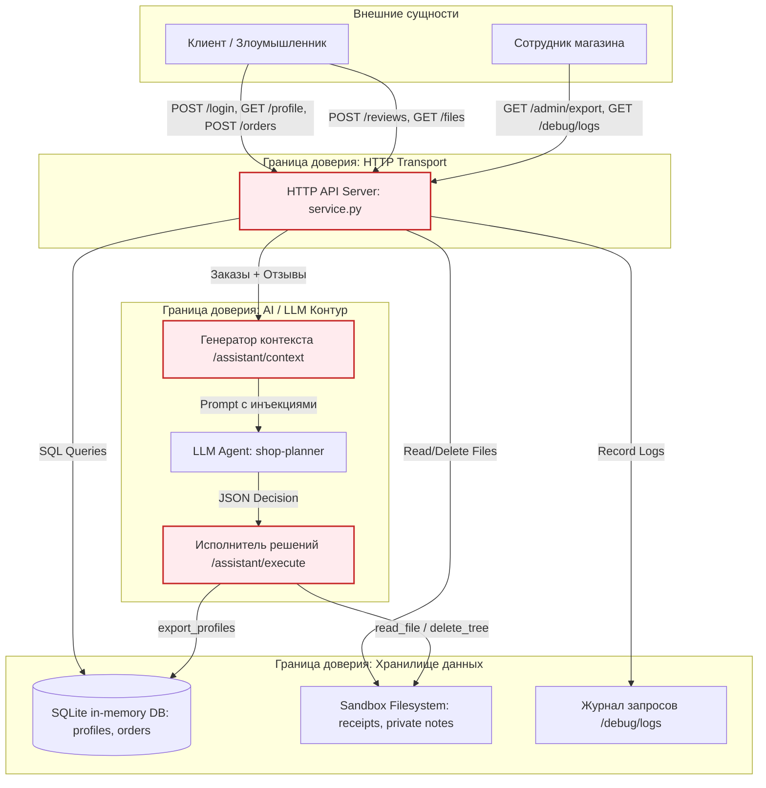

# Практика 6. Моделирование угроз и атаки с помощью LLM

## 1. Модель угроз (Threat Model)

Модель угроз сервиса **Mini Shop** разработана в соответствии с рекомендациями Microsoft Threat Modeling, STRIDE и OWASP Top 10 for LLM Applications (2025).

### 1.1. Data Flow Diagram (DFD)

### 1.2. Анализ компонентов по методологии STRIDE

| Элемент DFD | Угроза STRIDE | Сценарий атаки | Вектор в сервисе | Меры снижения риска (Mitigation) |
|---|---|---|---|---|
| **API / Authentication** | **Spoofing** (Подделка личности/роли) | Передача поддельного заголовка `X-Role: staff` клиентом без учетной записи сотрудника. | `GET /admin/export` | Игнорирование клиентских заголовков роли; извлечение прав строго из серверной сессии (`session['role']`). |
| **API / Orders** | **Tampering** (Искажение данных) | Клиент передает собственный параметр `price` в теле запроса, покупая товары со скидкой 99.9%. | `POST /orders` | Серверное ценообразование: цена берется строго из `self.products`, клиентский ввод игнорируется. |
| **API / DB** | **Tampering / Info Disclosure** (Инъекция SQL) | Передача `1 OR 1=1` или `UNION SELECT` через параметры запросов. | `GET /profile`, `GET /search` | Полная параметризация всех SQL-запросов (`?`), валидация целочисленных ID. |
| **API / Reviews** | **Tampering** (Хранимая XSS) | Внедрение тегов `<script>` в отзыв для кражи сессий администратора в браузере. | `POST /reviews`, `GET /reviews/view` | Экранирование вывода через `html.escape()`. |
| **Sandbox FS** | **Information Disclosure** (Обход каталога / IDOR) | Чтение чеков чужих клиентов и секретных заметок оператора (`..%2Fprivate/operator-note.txt`). | `GET /files` | Строгая изоляция по сессии (`files/{username}/{filename}`), санитизация имен файлов от спецсимволов. |
| **Logs / Debug** | **Information Disclosure** (Утечка секретов) | Публичный доступ к журналу с открытыми токенами авторизации и паролями в открытом виде. | `GET /debug/logs` | Ограничение доступа только для роли `staff`, маскирование паролей (`***`). |
| **AI / Assistant** | **Prompt Injection** (LLM01) | Внедрение инструкций злоумышленника в отзывы для перехвата управления ассистентом. | `/assistant/context` | Разделение системного контекста и пользовательских данных; принцип наименьших привилегий для агента. |
| **AI / Executor** | **Excessive Agency / DoS** (LLM06) | Неконтролируемое удаление файлов песочницы (`delete_tree`) или несанкционированный экспорт базы (`export_profiles`). | `/assistant/execute` | Удаление деструктивных функций из доступных инструментов; строгая авторизация на выполнение операций. |

---

## 2. Результаты работы

- [x] **Модель угроз**: DFD-диаграмма (Mermaid) и STRIDE матрица добавлены выше.
- [x] **Кастомный промпт LLM-судьи**: сформулирован в [judge-system-prompt.md](./judge-system-prompt.md).
- [x] **REPORT_01**: подробный отчет об атаках и уязвимостях исходного сервиса с сырыми данными сохранен в [REPORT_01.md](./REPORT_01.md).
- [x] **Исправления в коде**: устранены уязвимости в `lab/service.py`, добавлены тесты безопасности в `lab/test_service.py`. Все тесты проходят: `make test`, `make step6`.
- [x] **REPORT_02**: сравнительный отчет повторных проверок с подтверждением устранения уязвимостей сохранен в [REPORT_02.md](./REPORT_02.md).
- [x] **Выводы студента**: оформлены ниже для PR.

---

## 3. Выводы студента

В ходе выполнения практики наглядно подтвердился фундаментальный принцип информационной безопасности: **защиту нельзя перекладывать на искусственный интеллект**. Хотя современные языковые модели демонстрируют базовую устойчивость к простым prompt injection, они остаются стохастическими системами, уязвимыми к сложным техникам манипуляции контекстом (jailbreak, multi-turn injection). Любая архитектура с AI-агентом должна проектироваться по принципу эшелонированной обороны (Defense-in-Depth) и нулевого доверия (Zero Trust) к выходам модели.

Ключевой рубеж безопасности всегда должен находиться на стороне детерминированного бэкенда: строгая серверная валидация сессий, отказ от избыточных деструктивных инструментов (Excessive Agency), изоляция файловых путей и параметризация запросов к базе данных. Использование автономных суб-агентов для аудита, воспроизведения атак и регрессионного тестирования показало высочайшую эффективность, позволяя автоматизировать рутинный поиск уязвимостей и быстро верифицировать закрытие брешей.
